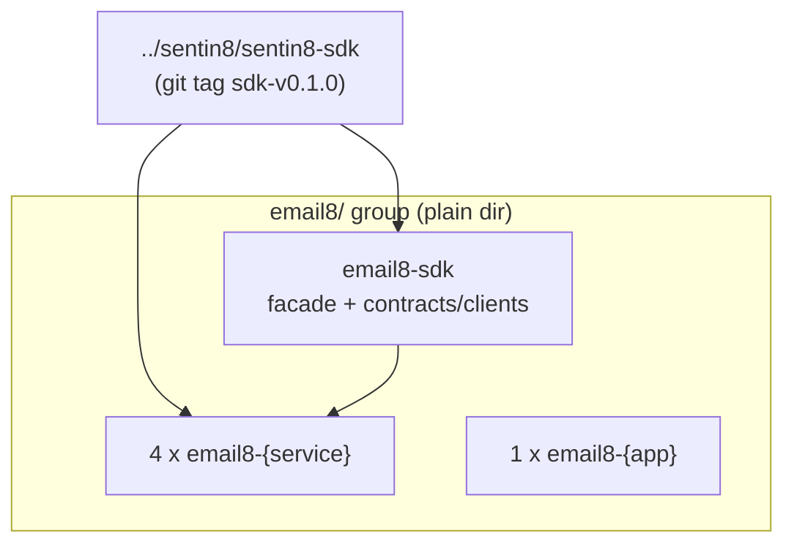

# email8/ - Email Vertical Group

> Secure Post-Quantum-Safe Email Platform That Heals and Scales Itself.

> Group-level design document for the Email vertical. Service-level
> design docs live in each repo (`email8-*/DESIGN.md`). The repository-split
> design of record: `../design/sentin8-repository-split-design.md`.

## 1. Scope & Context

The `email8` group is a business vertical on the Sentin8 platform. It owns
its **domain data** (database `email8`, created and schema-initialized via
`sentin8-cli vertical init`/`enroll` on the platform's shared PostgreSQL
instance) and its **domain services**. It owns NO infrastructure -
identity, TLS, eventing, scheduling, storage, and observability arrive
through the platform facade pins.

## 2. Dependency Contract

- Every service repo: `sentin8` (platform facade) + `email8` (vertical facade)
  git pins only - zero path deps (RS-5), zero platform-DB roles beyond the
  enroll-provisioned substrate (VDC).
- Event ownership: every `email8:…` event's first segment is `email8` -
  Bus's produce gate enforces it; the vertical claim is the service's
  **certificate identity** (CERTFREE-1: the TLS client certificate CN
  `m2m-{workload}` is the identity - no M2M token exists on the wire).
- Enrollment: composable - each repo ships `service-registration.json`;
  `sentin8-cli vertical enroll email8-ledger/ …` registers any subset.
  Each Rust service's fragment declares its `telemetry_property`
  (slug + name) - the CLI seeds `stat.properties` on the platform DB
  at init/enroll (TELESEED-1; a vertical's own init SQL can never
  reach the platform database).

### 2.1 Valkey plane (platform group DESIGN.md §3.1)

Email8 services reach Valkey ONLY through the platform's
cert-identity factory (`sentin8::middleware::valkey_client(url, workload)`
- GLIDE, `valkeys://` TLS, CN→ACL-user, no secrets) and present their own
`email8:{service}` workload identity. Each service declares its workload
in `m2m_grants` (the declaration drives enroll's ACL-user provisioning -
an undeclared workload has no ACL user and its connections are refused).
The MTA's rate-limit/greylist/fail2ban keys live in the `e8:{env}:*`
namespace, provisioned via the email8 enroll fragment's `valkey` section
(baseline ACL patterns do not cover it).

## 3. Data Model

One database per vertical (`email8`), schema-per-service, RLS mandatory, all
access via per-service OAuth-mapped PG roles - created by the CLI from
each repo's `--print-registration` output + `service-registration.json`
fragment (RS §6). Tiering (PROVRLS-1 -
`../design/sentin8-provisioned-rls-and-telemetry-design.md`): account
tables holder-or-admin, config tables env-tier, `principals` the
env-tier root (SELECT additionally admits the auth-user holder-match),
and `email8.domains` NO-RLS as the pre-tenant mail-domain→env
discovery catalog (the bank8-fdx `provider_profiles` precedent). The
tenant context is transaction-local - every stamp + query sequence runs
inside one explicit transaction.

## 4. Invariants

- The group folder is a plain directory - never a git repo or workspace.
- No `email8` repo carries a compose file (platform owns infra, §2.2.1).
- Verticals never depend on each other; all shared code is platform code.

## 5. Testing Strategy

Per-repo unit/integration suites (`make test`); cross-vertical flows via
`../sentin8/sentin8-e2e`.

## 5.1 Fleet-run scope (group operations, STARTSCOPE-1)

The group Makefile's `make start` boots ONLY the platform base
(`sentin8:acme, sentin8:auth, sentin8:proxy, sentin8:bus, sentin8:sys,
sentin8:bff, sentin8:web`) plus this group's services - the
`SENTIN8_SERVICES` boot pin when captain is down, the idempotent
`captain start <types>` API form when it is up. `make stop` stops only
this group's instance rows (the captain and platform stay up). The
full rule (service / group / tree-root scopes and the platform-scoped
dev reset): `design/sentin8-repository-split-design.md` §4.5.2.

## 6. Open Questions

- Platform-API drift sync where applicable (see split backlog, e.g.
  email8's RS-10).

---

**Architecture & Design:** email8 and its underlying concepts were designed by [Hamid Jahanzad](https://www.linkedin.com/in/hamidjahanzad/).
